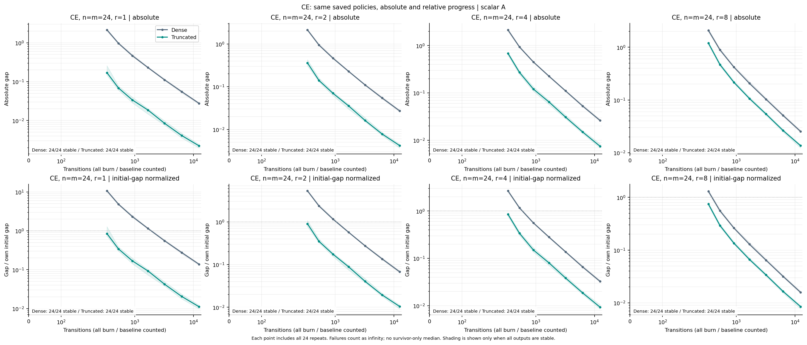
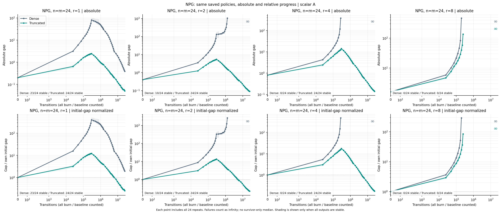
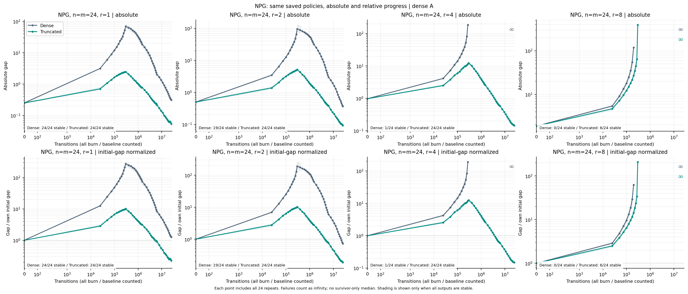

# CE/NPG 相对误差与多秩结果复核（2026-10-29）

本次直接核对并提取已有结果，未重新运行学习、策略评价或绘图，未提交新的 Grace 作业。

## 相对误差的准确含义

\[e_{\rm rel}(K)=\frac{J(K)-J_\star}{J(K_0)-J_\star}.\]

每个系统、每个输出先除以自己的初始 optimality gap，再对全部24个重复取中位数。
e=0.1表示还剩初始gap的10%；e>1表示比初始策略更差。CE分母同样是K0，而非首个拟合输出。
独立逐行核对全部96,600个输出：归一化除法与原始保存值完全一致，最大差异0；
全部8,690个失败输出仍按∞进入失败包含统计。没有用两个中位数之比代替逐实例归一化。

例如一个r=4截断NPG终端输出：0.15351677238153982 / 0.8022044591840778 = 0.19136863504558643。

## Exact-rank：固定 n=m=24，真实秩 r=1、2、4、8

这是四种真实系统秩的比较；已知秩截断方法保留k=r。每格24个重复，分别给出scalar A与耦合dense A。
以下都在各路线的固定终端预算比较dense与truncated：CE为12,432 transitions，NPG为25,075,008 transitions。
表内每对数字均为dense / truncated，relative为初始gap的比例。∞为保留失败后的中位数，不是缺失值。

### A=0.5I

|r|CE absolute|CE relative|NPG absolute|NPG relative|NPG稳定数/24|
|---:|---:|---:|---:|---:|---:|
|1|0.0276137 / 0.00223291|0.137689 / 0.0111339|0.394374 / 0.0511139|1.96645 / 0.254867|23/24 → 24/24|
|2|0.0272973 / 0.0042027|0.0680557 / 0.0104779|∞ / 0.0909193|∞ / 0.226674|10/24 → 24/24|
|4|0.0262458 / 0.00749323|0.0327171 / 0.0093408|∞ / 0.139525|∞ / 0.173927|0/24 → 24/24|
|8|0.0253904 / 0.0136137|0.0158254 / 0.00848518|∞ / ∞|∞ / ∞|0/24 → 0/24|

CE在这四个秩的两个方法中均为24/24稳定。

### 耦合dense A

|r|CE absolute|CE relative|NPG absolute|NPG relative|NPG稳定数/24|
|---:|---:|---:|---:|---:|---:|
|1|0.0275272 / 0.00241636|0.109788 / 0.00974361|0.311536 / 0.0544375|1.26407 / 0.224953|24/24 → 24/24|
|2|0.0271035 / 0.0045665|0.0542011 / 0.00911934|0.367561 / 0.092363|0.730946 / 0.186778|19/24 → 24/24|
|4|0.0255901 / 0.00801884|0.0262099 / 0.0082718|∞ / 0.146349|∞ / 0.150024|1/24 → 24/24|
|8|0.0231896 / 0.0127001|0.012364 / 0.00677573|∞ / ∞|∞ / ∞|0/24 → 6/24|

CE在这四个秩的两个方法中均为24/24稳定。

## 固定相对精度10%的预算

首个已测预算至少22/24成功才记达标。每格dense / truncated；NR为最大已测预算仍未达标。

|A|r|CE absolute≤0.1|CE relative≤0.1|NPG absolute≤0.1|NPG relative≤0.1|
|---|---:|---:|---:|---:|---:|
|0.5I|1|6,288 / 528|NR / 3,216|NR / 14,063,868|NR / NR|
|0.5I|2|6,288 / 912|12,432 / 3,216|NR / 25,075,008|NR / NR|
|0.5I|4|6,288 / 1,680|6,288 / 1,680|NR / NR|NR / NR|
|0.5I|8|6,288 / 3,216|3,216 / 1,680|NR / NR|NR / NR|
|耦合A|1|6,288 / 528|NR / 3,216|NR / 15,636,888|NR / NR|
|耦合A|2|6,288 / 912|12,432 / 1,680|NR / NR|NR / NR|
|耦合A|4|6,288 / 1,680|6,288 / 1,680|NR / NR|NR / NR|
|耦合A|8|3,216 / 3,216|3,216 / 1,680|NR / NR|NR / NR|

10%/3%/1%全部96行逐秩预算记录均保存在下方CSV；不把NR换成有限预算。

## 逐秩结论与边界

- CE在四个秩均获益，低秩时dense与truncated的差距更明显；r增大后优势缩小。
- NPG在r=1、2、4的截断方法均24/24稳定，终端相对gap明显小于dense；r=8依旧失败严重：scalar A两者均0/24稳定，耦合A为dense 0/24、truncated 6/24。
- n24的四个秩下，NPG两种方法均未达到至少22/24成功的相对10%标准；稳定性收益不能写成高精度达标。
- 跨真实秩时初始gap也变化，relative下降不能单独证明高秩更容易。scalar A的截断NPG从r1到r4，absolute中位数0.0511→0.1395，relative却0.2549→0.1739，因此保留两种口径。
- 已有网格是n24上的四个真实秩，以及r2上的n12/24/48维度扫描；没有把它描述成所有n×r的完整笛卡尔网格。

## 满秩系统的截断秩 k 扫描

这与上面的真实秩r变化是两个实验：满秩系统固定rank(B)=16，改变算法保留的k。
gapped与smooth谱在CE/NPG及两种A上均包含k=0、1、2、3、4、6、8、12、16；k16以dense记载。CE另有adaptive。
scalar A的NPG终端relative：gapped谱k2为0.10695、k8为0.15712、dense为0.17419；
smooth谱k2为0.22230、k8为0.11103、dense为0.11983。最佳保留秩随谱而变。
平坦谱NPG已有k2/k8/dense对照，relative分别0.38408/0.04137/0.01334，强截断损害性能。
不将平坦谱NPG的三个已有方法描述成九秩完整扫描。

## 可复核文件

- [全部逐秩学习曲线数据](../local_runs/ce-npg-rank-review-20261029/exact_rank_all_saved_budgets.csv)
- [32行逐秩终端统计](../local_runs/ce-npg-rank-review-20261029/exact_rank_terminal.csv)
- [96行逐秩absolute/relative达标预算](../local_runs/ce-npg-rank-review-20261029/exact_rank_precision_budgets.csv)
- [满秩各已有方法终端统计](../local_runs/ce-npg-rank-review-20261029/fullrank_terminal_all_saved_modes.csv)
- [独立归一化与覆盖复核收据](../receipts/ce-npg-rank-review-20261029.json)
- [原归一化补充完整结论](CE_NPG_INITIAL_GAP_FINDINGS_20261028.md)
